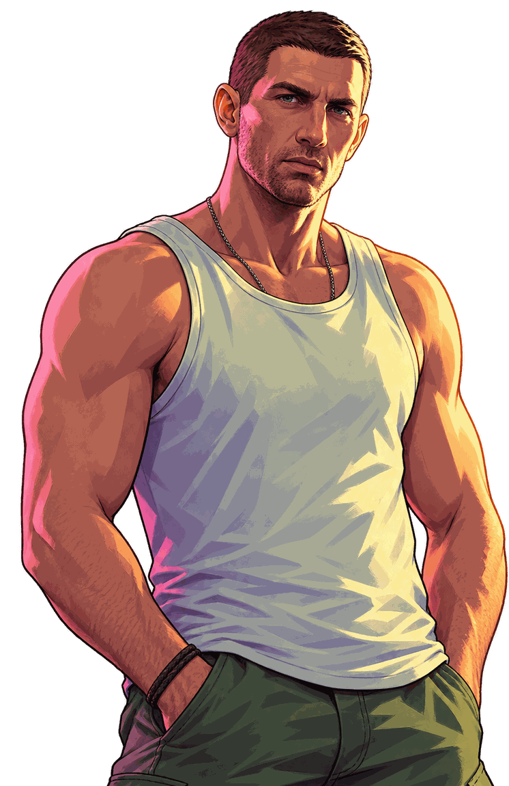

# 🌴 GTA IA

> **Não é só um jogo.** Escolha uma lenda de Dev City. Ou tire uma selfie e vire uma.

Tela de seleção de personagem inspirada no visual de GTA, feita com HTML, CSS e JavaScript puro. Ao clicar em cada personagem, o nome e a imagem mudam. Também é possível enviar uma foto da galeria ou tirar uma selfie com a câmera, e a **IA transforma você em um personagem de videogame**, com contorno grosso e cores vivas. Depois, é só **baixar a imagem final** com o seu personagem sobre o cenário do jogo.

---

## 📸 Preview

Acesse: https://gta-ia.vercel.app/


---

## ✨ Funcionalidades

- 🎮 **Seleção de personagem**: Lucia, Jason e CJ, cada um com a sua cor de destaque.
- 🔤 **Nome gigante dinâmico** atrás do personagem, no estilo das telas de loading do GTA.
- 📷 **Foto do usuário**: envio pela galeria ou captura direta pela câmera.
- 🤖 **Versão GTA gerada por IA**: a foto vira um personagem de videogame com fundo transparente, usando o [Puter.js](https://developer.puter.com/).
- ⬇️ **Baixar imagem**: depois que a IA gera o personagem, aparece o botão **Baixar imagem**. O arquivo PNG sai só com o cenário e o seu personagem, sem o nome "Você", sem o menu e sem os textos da tela.
- ⏳ **Tela de loading**: enquanto a IA gera a imagem, aparece só um "Loading..." animado, e o personagem entra quando fica pronto.
- 🛟 **Plano B**: se a IA falhar, a foto original é exibida no lugar.
- 📱 **100% responsivo**: celular em pé, celular deitado, tablet e desktop.
- 🎨 Visual com a fonte **Bangers** e paleta rosa/amarelo neon.

---

## 🧱 Tecnologias

- HTML5
- CSS3 (variáveis CSS, `clamp()`, `min()`, `dvh`, media queries)
- JavaScript (DOM, `getUserMedia`, `Canvas`, `FileReader`, `Blob`, `async/await`)
- [Puter.js](https://developer.puter.com/): geração de imagem por IA direto do front-end
- [Google Fonts: Bangers](https://fonts.google.com/specimen/Bangers)

---

## 📁 Estrutura do projeto

```
gta-ia/
├── img/
│   ├── background2.jpg
│   ├── lucia.png
│   ├── jason.png
│   ├── cj.png
│   └── imagem do projeto.png
├── index.html
├── scripts.js
└── styles.css
```

---

## 🚀 Como rodar

1. Clone o repositório:

   ```bash
   git clone https://github.com/seu-usuario/gta-ia.git
   ```

2. Abra a pasta no **VS Code**.
3. Rode com a extensão **Live Server** (clique direito em `index.html` → *Open with Live Server*).

> ⚠️ A câmera e a IA só funcionam em `localhost`, `127.0.0.1` ou em páginas com `https`. Abrir o arquivo direto no navegador (`file://`) não libera o acesso.

> 💡 Na primeira geração, o Puter pode pedir para você entrar ou criar uma conta gratuita.

---

## 🧠 Como funciona

Cada bolinha do menu guarda as informações do personagem em atributos `data-*`:

```html

```

Ao clicar, o JavaScript lê esses dados e atualiza o nome, a cor do nome e a imagem do personagem.

O botão 📸 abre um menu com duas opções:

- **Galeria**: abre o seletor de arquivos e usa a imagem escolhida.
- **Câmera**: abre o vídeo ao vivo e captura o frame em um `canvas`.

Depois de escolher a foto, o fluxo é este:

1. A foto é lida com o `FileReader` e convertida em um link (`readAsDataURL`).
2. O site mostra o texto **Loading...** e esconde o personagem.
3. A foto é enviada para a IA com `puter.ai.txt2img`, junto com um prompt pedindo o estilo de videogame e fundo transparente.
4. A imagem gerada entra no lugar do personagem, o nome vira **Você** e o botão **Baixar imagem** aparece.

Se o usuário clicar em outro personagem durante o loading, a geração é descartada para não sobrescrever a nova escolha.

### ⬇️ Como o download funciona

Ao clicar em **Baixar imagem**, o JavaScript monta o resultado num `canvas` escondido, sem usar nada do que aparece na tela:

1. Carrega o `background2.jpg` e a imagem gerada pela IA (convertida em `Blob` local, para o canvas não ser bloqueado por CORS).
2. Desenha o cenário no tamanho original e, por cima, o personagem centralizado e colado embaixo, ocupando 85% da altura.
3. Exporta o `canvas` como PNG (`toBlob`) e dispara o download com o nome `eu-em-versao-gta.png`.

Como o nome gigante, o menu e os textos são elementos HTML e não são desenhados no `canvas`, eles não aparecem no arquivo baixado. O botão some ao trocar de personagem e só volta quando uma nova versão GTA é gerada.

---

> 🔐 **Sem chave de API no front-end:** o Puter.js cuida da autenticação, então nenhuma chave fica exposta no código. Se um dia você trocar para outro serviço de IA, use sempre um servidor intermediário.

---

## 🙏 Créditos

Este projeto foi desenvolvido com o apoio das aulas do **Rodolfo Mori | DevClub**, na **Missão Programação com IA do Zero - Edição GTA! 🎮**. Obrigada pelo conteúdo e por ensinar a construir com IA desde o primeiro passo! 💜

- 🎓 [DevClub](https://aulas.devclub.com.br/)

---

## ⚖️ Aviso

Este é um projeto de estudo, sem fins comerciais. Qualquer referência visual a GTA pertence aos seus respectivos detentores de direitos (Rockstar Games). Este projeto não é afiliado nem endossado por eles.
